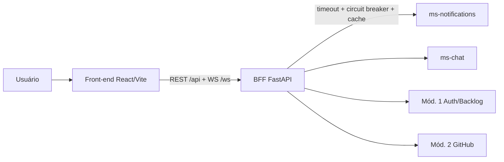

# 🖥️ ms-dashboard — Portal Web e BFF do Módulo 6

> **Módulo 6 — Dashboard, Central de Notificações e Comunicação**
> Portal web central da plataforma **Assistente Inteligente de Engenharia de Software**
> Universidade Presbiteriana Mackenzie · Projeto de Engenharia de Software com Microsserviços · 2026-2


Este repositório é o **`ms-dashboard`**: o **portal web** (front-end React) por onde o usuário
chega às funcionalidades do Módulo 6, e o **BFF (Backend for Frontend)** que agrega as métricas
e encapsula os demais serviços da plataforma.

> A visão geral completa do Módulo 6 e da plataforma está em
> [`docs/visao-geral-modulo6.md`](docs/visao-geral-modulo6.md).

## O que este serviço faz

- **Portal central**: navbar + Dashboard, Notificações e Chat, com tema claro/escuro e layout responsivo.
- **Dashboard de métricas**: agrega commits, PRs, reviews e User Stories dos Módulos 1 e 2.
- **Central de notificações**: consome o `ms-notifications`, exibe feed, sino com contador e toasts em tempo real.
- **Chat da equipe**: consome o `ms-chat`, com salas por projeto e mensagens em tempo real.

## O que este serviço **não** faz

Estas responsabilidades são de outros serviços do Módulo 6, consumidos por este portal:

| Responsabilidade | Serviço dono |
|------------------|--------------|
| Ingestão de eventos, priorização por IA, persistência de notificações | `ms-notifications` |
| Persistência e entrega do chat | `ms-chat` |
| Emissão/validação de identidade (JWT), papéis e membros | Módulo 1 (Auth/Backlog) |
| Métricas de código e PRs | Módulo 2 (GitHub) |

## Arquitetura



- O BFF é organizado em camadas: **rotas → serviços/agregador → clients**.
- Toda chamada a serviço externo passa por `guarded_call` (timeout + circuit breaker + cache da
  última resposta válida). **A falha de um serviço downstream nunca derruba o portal** — apenas a
  área afetada mostra "indisponível no momento" (degradação graciosa).
- Os clients têm interface (`Protocol`) com implementação **mock** e **HTTP**, selecionadas por
  `USE_MOCKS`. Com `USE_MOCKS=true`, o portal roda e é demonstrável sem os outros grupos no ar.

## Como executar

### Opção A — Docker (um comando)

```bash
docker compose up --build
```

- Portal: http://localhost:8080
- BFF (Swagger): http://localhost:8006/docs

### Opção B — Desenvolvimento local

Pré-requisitos: Python 3.12 e Node.js 20+.

**BFF:**
```bash
cd backend
python -m venv .venv
.venv\Scripts\activate        # Windows (PowerShell: .venv\Scripts\Activate.ps1)
pip install -e ".[dev]"
uvicorn app.main:app --reload --port 8006
```

**Front-end** (em outro terminal):
```bash
cd frontend
npm install
npm run dev                    # http://localhost:5173
```

O Vite encaminha `/api` e `/ws` para o BFF em `localhost:8006` (ver `vite.config.ts`).

### Login de desenvolvimento

Sem o Módulo 1 no ar, use o login de desenvolvimento na tela inicial (Product Owner, Scrum
Master ou Desenvolvedor). Os tokens de teste vêm de `GET /api/bff/dev/tokens`, disponível quando
`APP_ENV=development` **ou** quando `ENABLE_DEV_LOGIN=true`.

> **Produção/demonstração:** como o Módulo 1 (autenticação real) ainda não existe, o deploy liga
> `ENABLE_DEV_LOGIN=true` para permitir a demonstração. Esse login gera tokens de qualquer perfil
> **sem senha** — portanto **desligue-o** (`ENABLE_DEV_LOGIN=false`) assim que a autenticação real
> estiver integrada.

## Deploy na nuvem (Render, via Docker)

Cada serviço do Módulo 6 roda como um contêiner independente com uma URL pública, para que os
módulos da plataforma se integrem consumindo as APIs uns dos outros. O deploy usa o
[`render.yaml`](render.yaml) (Blueprint do [Render](https://render.com)), que cria **dois
serviços web Docker**: `ms-dashboard-bff` (BFF) e `ms-dashboard-web` (portal). O Render constrói
as imagens na nuvem a partir dos `Dockerfile` do repositório — não é preciso ter Docker na sua
máquina para o deploy (só para testar localmente).

### Passo a passo

1. Garanta que o repositório está no GitHub (branch `main`).
2. No Render: **New ▸ Blueprint** e conecte este repositório. O Render lê o `render.yaml` e
   propõe os dois serviços.
3. O Render pede o valor das variáveis marcadas como `sync: false`. Na primeira criação, deixe-as
   em branco (ou um valor provisório) para o Render gerar as URLs `*.onrender.com`.
4. Com as URLs geradas, preencha cada uma com a URL do **outro** serviço e salve:
   - no `ms-dashboard-bff`, `CORS_ORIGINS` = URL pública do portal
     (ex.: `https://ms-dashboard-web.onrender.com`);
   - no `ms-dashboard-web`, `VITE_API_BASE_URL` = URL pública do BFF
     (ex.: `https://ms-dashboard-bff.onrender.com`).
5. O portal é reconstruído com a URL correta do BFF. Abra a URL do `ms-dashboard-web` e use o
   login de desenvolvimento.

> **Por que preencher as URLs manualmente?** No Render, o auto-wiring `fromService ... property:
> host` devolve o host da **rede privada** (interno e sem `https://`). Como o navegador acessa o
> BFF pela internet e o CORS precisa da origem pública, essas duas URLs são informadas à mão.

### Integração com os outros módulos

Enquanto `ms-notifications`, `ms-chat` e os Módulos 1 e 2 não estão publicados, o BFF roda com
`USE_MOCKS=true` e o portal funciona sozinho com dados simulados. Quando os colegas publicarem os
serviços, troque no `ms-dashboard-bff`:

- `USE_MOCKS=false`;
- `NOTIFICATIONS_URL`, `CHAT_URL`, `BACKLOG_URL`, `GITHUB_URL` com as URLs reais.

Nenhuma mudança de código é necessária — só variáveis de ambiente.

### Outros provedores

O mesmo par de `Dockerfile` roda em Railway, Fly.io, uma VPS ou qualquer host que aceite Docker.
Basta expor o BFF e o portal, e configurar `VITE_API_BASE_URL` (build do portal) e `CORS_ORIGINS`
(BFF) com as URLs públicas correspondentes. Lembre que o portal (nginx) escuta na porta `PORT`
(o Render define automaticamente; o padrão da imagem é 80).

## Variáveis de ambiente

Copie `backend/.env.example` para `backend/.env` e ajuste se necessário.

| Variável | Padrão | Descrição |
|----------|--------|-----------|
| `APP_ENV` | `development` | `development`/`staging`/`production` |
| `PORT` | `8006` | Porta do BFF |
| `USE_MOCKS` | `true` | Usa mocks dos serviços downstream |
| `JWT_SECRET` | `dev-secret-change-me` | Segredo para validar o JWT do Módulo 1 |
| `JWT_ALGORITHM` | `HS256` | Algoritmo do JWT |
| `CORS_ORIGINS` | `http://localhost:5173` | Origens permitidas (separadas por vírgula) |
| `NOTIFICATIONS_URL` | — | URL do `ms-notifications` (quando `USE_MOCKS=false`) |
| `CHAT_URL` | — | URL do `ms-chat` |
| `BACKLOG_URL` | — | URL do Módulo 1 |
| `GITHUB_URL` | — | URL do Módulo 2 |
| `UPSTREAM_TIMEOUT_SECONDS` | `3.0` | Timeout das chamadas externas |
| `CIRCUIT_BREAKER_FAILS` | `5` | Falhas para abrir o circuit breaker |
| `CACHE_TTL_SECONDS` | `30.0` | TTL do cache da última resposta válida |

**Front-end (tempo de build):** `VITE_API_BASE_URL` define a URL pública do BFF usada pelo
portal. Vazio (padrão) = caminhos relativos (`/api`, `/ws`), usados em dev e no docker-compose.
Na nuvem, informe a URL completa do BFF (ex.: `https://ms-dashboard-bff.onrender.com`).

## API do BFF

Documentação interativa (OpenAPI) em `/docs`. Rotas principais (exigem `Authorization: Bearer <JWT>`):

| Método | Rota | Descrição |
|--------|------|-----------|
| `GET` | `/api/bff/dashboard?project_id=` | Métricas agregadas (cards + série semanal) |
| `GET` | `/api/bff/notifications` | Lista (filtros `priority`, `source`, `status`, `cursor`, `limit`) |
| `GET` | `/api/bff/notifications/unread-count` | Contador de não lidas |
| `PATCH` | `/api/bff/notifications/{id}` | Marca como lida |
| `POST` | `/api/bff/notifications/read-all` | Marca todas como lidas |
| `GET` | `/api/bff/chat/rooms/{project_id}/messages` | Histórico da sala |
| `POST` | `/api/bff/chat/rooms/{project_id}/messages` | Envia mensagem |
| `GET` | `/api/bff/dev/tokens` | Tokens de teste (só em `development`) |
| `WS` | `/ws/notifications?token=` | Notificações em tempo real |
| `WS` | `/ws/chat?project_id=&token=` | Chat em tempo real |
| `GET` | `/health` · `/ready` | Liveness / readiness |

## Contratos consumidos dos outros serviços

Enquanto os serviços reais não sobem, o BFF usa mocks com o **mesmo formato** esperado dos
contratos abaixo (propostos; a validar com os grupos). Os schemas estão em
[`backend/app/domain/schemas.py`](backend/app/domain/schemas.py).

- **ms-notifications**: `GET /api/v1/notifications` (paginado, filtros), `/unread-count`,
  `PATCH /{id}`, `POST /read-all`, WS `/ws/notifications`.
- **ms-chat**: `GET/POST /api/v1/rooms/{project_id}/messages`, WS `/ws/chat`.
- **Módulo 1 (backlog)**: resumo de User Stories e reviews pendentes por projeto.
- **Módulo 2 (github)**: commits/PRs por semana e PRs abertos por projeto.

Para trocar os mocks pelos serviços reais: defina `USE_MOCKS=false` e as URLs correspondentes.

## Identidade visual

A interface segue o guia em [`.kiro/steering/design-system.md`](.kiro/steering/design-system.md):
tokens como CSS variables + `theme.extend` do Tailwind, cor indicando prioridade e ícone/rótulo
indicando a origem, Inter + JetBrains Mono, `tabular-nums` nos números, modo claro/escuro e WCAG AA.

## Qualidade e testes

```bash
# BFF
cd backend && .venv\Scripts\python.exe -m pytest -q

# Front-end
cd frontend && npm run test
```

- **BFF**: resiliência (timeout/breaker/cache), degradação graciosa do dashboard, auth e papéis,
  rotas de notificações e chat (incluindo estados de indisponibilidade e WebSocket).
- **Front-end**: prioridade → cor no card e estado de indisponibilidade.

## Estrutura do repositório

```
.
├── backend/            # BFF FastAPI (core, clients, dashboard, notifications, chat)
│   ├── app/
│   └── tests/
├── frontend/           # Portal React + TS + Vite + Tailwind + Recharts
│   └── src/ (auth, theme, hooks, components, features/{dashboard,notifications,chat})
├── docs/               # Visão geral do Módulo 6
├── .kiro/              # Spec (requirements/design/tasks) e steering (design-system)
└── docker-compose.yml  # Sobe portal + BFF
```

## Licença

MIT. Projeto acadêmico — Engenharia de Software, UPM, 2026-2.
