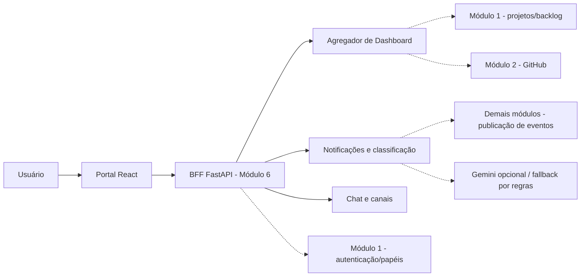

# Relatório final — Módulo 6: Dashboard, Central de Notificações e Comunicação

**Disciplina:** Engenharia de Software — Universidade Presbiteriana Mackenzie  
**Projeto:** Plataforma de Assistente Inteligente de Projetos de Engenharia de Software, Code Review e Curadoria Técnica  
**Semestre:** 2026/2 · **Marco de entrega:** AP2, 13/11/2026 (conforme enunciado)  
**Equipe:** [PREENCHER INTEGRANTES E RESPONSABILIDADES]  
**Repositório:** https://github.com/gabicds13/Projeto_Engenharia_de_Software  
**Versão analisada:** `main`, commit `f99b08ea2659250e9e43f608d59ffd7b24dd351d` (antes da documentação final)

> **Natureza das evidências:** relatório baseado no enunciado da disciplina, no cronograma do Módulo 6 e no código e pipelines do repositório. Testes automatizados e conclusão do workflow de deploy são evidências distintas de testes manuais de ponta a ponta; não afirmamos homologação visual ou integração total com outros grupos.

## 1. Introdução e problema

O projeto interdisciplinar propõe uma plataforma integrada em microsserviços com recursos de Inteligência Artificial para centralizar artefatos, atividades de engenharia de software e sugestões técnicas. Dentro desse ecossistema, o **Módulo 6** é responsável por disponibilizar o portal visual central do sistema, apresentar métricas do projeto, reunir alertas e notificações em tempo real e permitir comunicação entre integrantes da equipe.

O principal desafio técnico do módulo consiste em conciliar três fluxos de dados — indicadores de desenvolvimento, notificações priorizadas e mensagens — sem tornar todo o portal indisponível quando uma fonte externa falha. Outro desafio é diferenciar a experiência demonstrável com dados simulados das integrações operacionais que dependem de serviços de outros grupos.

## 2. Objetivos

**Objetivo geral:** implementar o portal de Dashboard, Central de Notificações e Comunicação, com análise e priorização de alertas por relevância, aplicação de segurança baseada na identidade do usuário e tolerância a falhas de microsserviços externos.

**Objetivos específicos:**
- Exibir métricas de commits, Pull Requests, reviews e User Stories por projeto.
- Oferecer uma central de notificações com categorias, prioridades, filtros, contador de não lidas e atualização por WebSocket.
- Disponibilizar Chat geral por projeto e conversas privadas entre integrantes, com histórico e recursos de leitura.
- Integrar regras de classificação de urgência, personalização por perfil e opção de modelo generativo com fallback por regras.
- Validar autenticação/autorização e evitar exposição de dados entre usuários e projetos.
- Aplicar padrões de resiliência e automatizar análise de qualidade, testes e deploy.

## 3. Escopo e arquitetura

A implementação reúne um **frontend React, TypeScript e Vite**, um **BFF FastAPI em Python**, persistência opcional em banco relacional via **SQLAlchemy/Alembic**, canais WebSocket e clientes de integração HTTP. O frontend concentra as páginas Dashboard, Notificações, Chat, login e navegação; o backend fornece endpoints próprios, agrega dados e atende requisições do frontend.

**Fluxo lógico (não equivale a comprovação de todas as integrações):**

**Fronteiras:** o Chat do Módulo 6 é comunicação entre pessoas, não o assistente RAG do Módulo 7. A entrada de eventos de outros módulos é disponibilizada por contrato de API, mas não se deve confundir existência do endpoint com integração real e contínua de todos os produtores.

## 4. Funcionalidades desenvolvidas

### 4.1 Dashboard
O Dashboard possui cartões de commits na semana, PRs abertos, reviews pendentes e User Stories por status, além de gráfico semanal. Permite troca do projeto selecionado, mostra rótulos para dados demonstrativos (mocks), preserva respostas anteriores em falhas temporárias e indica quando métricas individuais ficam indisponíveis. O agregador usa consultas independentes e assíncronas aos clientes de origem.

**Limite:** a métrica `reviews_pending` ainda não possui fonte HTTP efetiva no cliente real de Backlog; o método correspondente lança erro de serviço não suportado. Alguns indicadores dependem dos contratos e da disponibilidade dos demais módulos. O projeto não deve apresentar esses números mockados como métricas reais.

### 4.2 Central de Notificações
A interface mostra feed, categorias por origem, prioridade, ordenação, filtros, notificação lida/não lida, contador e avisos (toasts). O backend disponibiliza consulta paginada, contagem, marcação de leitura e publicação de eventos com `event_id`. Os eventos podem ser propagados em tempo real por WebSocket; a tela exibe opção de nova tentativa em caso de indisponibilidade.

**Limites:** uma parte da experiência pode depender de mocks ou de banco e serviços configurados; configurações avançadas de preferências, como tela individual de silenciamento de categorias, não foram comprovadas como concluídas no frontend. O cenário demonstrativo de IA é explicitamente identificado como simulado.

### 4.3 Comunicação
A aplicação contém Chat geral por projeto (envio, histórico, mensagens em tempo real, leitura e contagem de não lidas) e conversas privadas com criação, convite/aceite, histórico e controle de membros. A etapa 4 acrescentou proteção contra troca de projeto durante respostas atrasadas, preservação do rascunho quando o envio falha, botão de nova tentativa e acesso ao Chat privado mesmo quando o geral fica indisponível.

**Limites:** funcionalidades que dependem de banco configurado, usuários reais e canais ativos não foram homologadas de ponta a ponta em produção nesta documentação.

### 4.4 Segurança
A camada de backend inclui verificação de JWT e acesso por projeto, rejeição de acesso não autorizado e isolamento do cache de notificações por usuário, permissões e filtros. A alteração do acesso invalida o escopo da consulta; os testes incluem casos com token inválido/expirado, autenticação de desenvolvimento desabilitada em produção e regressões de vazamento de cache. O projeto preserva a diferença entre um perfil inferido e um papel confirmado pelo Módulo 1.

**Limite:** os testes automatizados não substituem auditoria de segurança, revisão de configuração real nem avaliação de autorização de todos os serviços externos.

## 5. Inteligência Artificial

O módulo possui **classificação local por regras** de urgência e relevância, com prioridade crítica/alta/média/baixa; pode também usar **Gemini via endpoint compatível com Chat Completions**, caso o responsável configure e habilite as credenciais. O classificador processa informações do evento e espera os campos `priority`, `relevance_score`, `reason`, `summary` e `group_key`. Em erros de comunicação, timeout ou JSON inválido, o sistema emprega regras locais.

A personalização considera papéis reais do Módulo 1 quando verificados; há endpoint de **prévia contextual autenticada** que não persiste alterações, separadamente do fluxo de publicação global.

**Limite relevante para a apresentação:** a presença do código e testes simulados **não comprova** que o Gemini respondeu com sucesso no ambiente de produção ou que houve acurácia quantitativa medida com dataset externo. Não foram encontrados resultados validados de acurácia para citar. O modelo configurado pode mudar por ambiente; não se deve fixar no relatório um nome de modelo como se tivesse sido confirmado em execução.

## 6. Robustez e tratamento de falhas

O BFF implementa timeout, circuit breaker, cache do último resultado disponível e respostas de degradação graciosa. O Dashboard não precisa sair do ar quando uma fonte falha; Chat e Notificações não devem se derrubar mutuamente. Testes simulam falha simultânea de Módulos 1 e 2, recuperação do circuit breaker, revalidação do cache, e indisponibilidade de Chat/Notificações.

**Limite:** os testes de falha são controlados/automatizados. Uma simulação de queda não substitui um ensaio de caos operacional em ambiente compartilhado com outros grupos, especialmente no Azure.

## 7. Qualidade, testes e CI/CD

Em **13/11/2026**, a execução de validação `43517866360` registrou:

| Verificação | Resultado |
|---|---|
| Backend — pytest | **122 testes aprovados**, 3 warnings |
| Frontend — Vitest | **24 testes aprovados** em 8 arquivos |
| Ruff (backend) | Aprovado |
| TypeScript e build do frontend | Aprovados |

Fonte: https://github.com/gabicds13/Projeto_Engenharia_de_Software/actions/runs/43517866360

A automação usa GitHub Actions. Para a versão `f99b08e` (revisão da etapa 4), os workflows de deploy para `software6-web`, `software6-bff` e `software6-bff-2` foram concluídos com **success**. Esse status confirma as etapas do pipeline, não um teste visual do site.

## 8. Gestão do projeto

O grupo utiliza um fluxo de desenvolvimento com branches, Pull Requests e integração na `main`. O planejamento do Módulo 6 recomenda os épicos M6-E1 (Dashboard), M6-E2 (Notificações), M6-E3 (Chat), M6-E4 (IA), M6-E5 (Integrações/robustez), M6-E6 (Qualidade/CI/CD) e M6-E7 (Documentação/apresentação), além de organização por sprint no YouTrack. **A atualização efetiva de todas as tarefas no YouTrack não foi verificada** e deve ser conferida por um integrante antes da entrega.

Os PRs #11–#19 consolidam Chat, Notificações, IA, resiliência, segurança, revisão de interface e testes. Para rastreabilidade, consultar `docs/evidencias-entrega-ap2.md`.

## 9. Resultados e avaliação do que foi atingido

O repositório contém uma solução integrada de frontend e BFF para o Módulo 6, com camadas bem separadas, testes automatizados aprovados e deploy executado pelos pipelines. A experiência pode ser demonstrada com dados de exemplo, identificados como simulados. Como resultado de engenharia, destacam-se o isolamento de falhas, os testes de permissões e a recuperação dos fluxos do Chat.

**Não estão comprovados como concluídos:** integração total com os demais grupos (inclusive o assistente RAG M7), avaliação real de acurácia da IA com dataset rotulado, verificação visual manual em desktop e celular, testes operacionais do portal com serviços externos simultaneamente ativos e execução de ensaio final integrado.

## 10. Considerações finais

O Módulo 6 atendeu ao núcleo implementável localmente de portal, métricas, notificações e comunicação, incorporando técnicas de engenharia de software como separação em camadas, testes automatizados, autenticação, fallback, circuit breaker, versionamento, PRs e CI/CD. A distinção entre comportamento validado em testes isolados e integração operacional preserva a transparência da avaliação.

Para fechamento da AP2, é necessário anexar as evidências visuais disponíveis, registrar a participação individual de cada integrante, verificar o funcionamento do portal no navegador e confirmar os requisitos de submissão utilizados pelo professor.

## 11. Contribuições individuais (preenchimento obrigatório)

| Integrante | Papel/atividade realizada | Issues, commits ou PRs | Evidências individuais |
|---|---|---|---|
| [NOME 1] | [CONTRIBUIÇÃO REAL] | [LINKS] | [LINKS/PRINTS] |
| [NOME 2] | [CONTRIBUIÇÃO REAL] | [LINKS] | [LINKS/PRINTS] |
| [NOME 3] | [CONTRIBUIÇÃO REAL] | [LINKS] | [LINKS/PRINTS] |

Não inventar horas, cargos, atribuições nem participação. Cada aluno deve adaptar e submeter conforme a orientação da turma.

## 12. Referências

- Universidade Presbiteriana Mackenzie. *Projeto de Engenharia de Software com Microsserviços 2026-2*. Enunciado da disciplina fornecido à equipe (2026).
- Equipe do Módulo 6. *Cronograma Módulo 6 — YouTrack*. Documento de planejamento fornecido à equipe (2026).
- Equipe do Módulo 6. *Projeto_Engenharia_de_Software*. Repositório: https://github.com/gabicds13/Projeto_Engenharia_de_Software (acesso em 13 nov. 2026).
- Evidências de validação: https://github.com/gabicds13/Projeto_Engenharia_de_Software/actions/runs/43517866360
